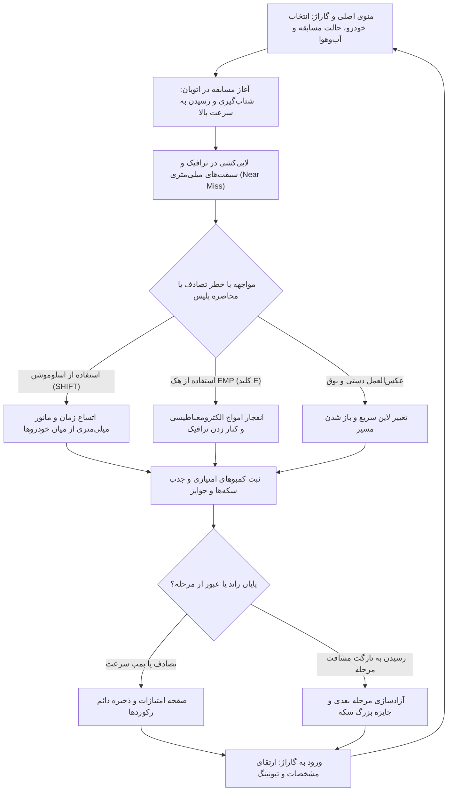

# سند جامع طراحی بازی (Game Design Document - GDD)
## پروژه اتومبیل‌رانی آرکید سایبرپانک: «Neon Highway»
### پروژه درس مبانی بازی‌سازی (Game Design Fundamentals)

---

| مشخصه پروژه | اطلاعات |
| :--- | :--- |
| **عنوان رسمی بازی** | Neon Highway (بزرگراه نئونی) |
| **ژانر و سبک** | Arcade Highway Racer / Cyberpunk Time-Bending Action |
| **پلتفرم‌های مقصد** | ویندوز دسکتاپ (Windows Desktop Executable x64) و وب/PWA |
| **موتور بازی‌سازی** | موتور گرافیکی اختصاصی دو بعدی بر پایه HTML5 Canvas API (توسعه‌یافته از صفر بدون فریم‌ورک آماده) |
| **معماری کد** | Vanilla JavaScript ES6+ ماژولار شیءگرا، CSS3 Glassmorphism، Web Audio API |
| **نرخ فریم هدف** | ۶۰ الی ۱۲۰ فریم بر ثانیه پایدار (High-Refresh Desktop Rasterization) |
| **تاریخ تدوین نسخه نهایی** | آبان ۱۴۰۳ (نسخه نهایی نهایی - Release 2.5) |

### 👥 اعضای تیم توسعه و سمت‌های تخصصی:
1. **رسول استواری** — مدیر فنی و معمار سیستم (Lead Engine Architect & Systems Integrator)
2. **احسان کاظمی** — مهندس فیزیک خودرو و استقرار دسکتاپ (Physics & Desktop Deployment Engineer)
3. **مریم ناظم‌سادات** — توسعه‌دهنده گرافیک رویه‌ای، سیستم ذرات و شیدرها (Graphics, Shaders & VFX Specialist)
4. **هانیه کاویانی** — مهندس هوش مصنوعی ترافیک، صوت و گیمیفیکیشن (AI, Audio & Gameplay Engineer)

---

## ۱. فلسفه طراحی و خلاصه اجرایی (High Concept & Vision)

### ۱.۱. خلاصه اجرایی (Executive Summary)
بازی **Neon Highway** یک اثر اتومبیل‌رانی آرکید با ریتم تند و تم سایبرپانک در آینده‌ای پادآرمان‌شهری است. بازیکن در نقش راننده‌ای حرفه‌ای سوار بر مدرن‌ترین خودروهای مجهز به فناوری‌های نامتعارف، در اتوبان‌های بی‌انتها با سرعت‌های فراتر از ۲۰۰ کیلومتر بر ساعت به لایی‌کشی، رقابت و فرار از پلیس می‌پردازد.

وجه تمایز بنیادین این بازی، **خلاقیت مکانیکی در ادغام دو قابلیت تاکتیکی سایبری** (اسلوموشن واکنشی برای کند کردن زمان و هک پالس الکترومغناطیسی برای باز کردن لاین‌های ترافیک) به همراه **هاب کابین تله‌متری زنده برای نمایشگرهای دسکتاپ** است که تجربه‌ای کاملاً فراتر از عناوین ساده رانندگی دوبعدی ارائه می‌دهد.

### ۱.۲. ستون‌های بنیادین طراحی (Core Pillars):
1. **آدرنالین سرعت و کنترل واکنش‌گرای ۶۰ فریم (High-Octane Responsive Controls):**
   شروع رانندگی مستقیماً در سرعت‌های بالا با ورودی‌های کامپیوتر (Keyboard-First) بدون لگ و با پاسخ‌دهی میلی‌ثانیه‌ای در نرخ فریم ۶۰ تا ۱۲۰.
2. **مکانیک‌های خلاقانه و سایبرپانک (Creative Cyber Gameplay):**
   بهره‌گیری از انرژی سایبری ذخیره‌شده جهت تحریک اتساع زمان (Bullet-Time Slowmo) و صدور امواج الکترومغناطیسی (EMP Shockwave) برای کنترل میدان ترافیک.
3. **تله‌متری پیشرفته دسکتاپ (Cockpit Telemetry & Tactical Radar):**
   تبدیل مانیتورهای عریض به کابین پرواز سایبرپانک شامل تاخومتر آنالوگ، نشانگر دنده، رادار زنده ماهواره‌ای و پایشگر شتاب گریز از مرکز (G-Force).
4. **هوش مصنوعی هوشمند با فیزیک ضدتداخل (Anti-Overlap Reactive Traffic):**
   ترافیک شهری که دچار تصادف‌های ناخواسته یا تداخل اسپرایتی درون یکدیگر نمی‌شود، قابلیت سبقت و واکنش به بوق دارد و گشت‌های ویژه پلیس با تاکتیک محاصره دوجانبه (Flanking) به بازیکن هجوم می‌آورند.
5. **اتمسفر صوتی-تصویری چشم‌نواز (Retro Synthwave & Procedural Neon Art):**
   نورپردازی‌های نئونی، باران و آسفالت خیس، و موسیقی الکترونیک سینث‌ویو تولیدشده به روش سنتز رویه‌ای توسط Web Audio API.

---

## ۲. حلقه اصلی گیم‌پلی (Core Gameplay Loop)



### مراحل چرخه تجربه کاربر:
1. **آماده‌سازی (Preparation):** بررسی ماموریت‌های فعال، انتخاب خودرو و تنظیم رنگ نئون در گاراژ.
2. **رانندگی پرسرعت (High-Speed Cruising):** هدایت خودرو در اتوبان ۴ بانده با حداکثر سرعت.
3. **تصمیم‌گیری میلی‌ثانیه‌ای (Micro-Tactics):** مدیریت کپسول نیترو، سنجش فاصله خطر و انتخاب لاین مناسب با کمک رادار زنده.
4. **فعال‌سازی توانایی‌های سایبری (Ability Execution):** کند کردن زمان برای گریز از معبرهای غیرممکن یا منفجر کردن سیستم هدایت پلیس با پالس EMP.
5. **پاداش و ارتقا (Progression & Tuning):** جمع‌آوری سکه‌ها، دریافت نشان‌های افتخار، ارتقای ۵ فاکتور اصلی خودروها و بازگشت به میدان با خودروهای سریع‌تر.

---

## ۳. حالات بازی و مراحل خط داستانی (Game Modes & Career Stages)

### ۳.۱. حالات مسابقه (Game Modes):
| حالت مسابقه | کد فنی | توصیف مکانیک و شرایط پیروزی/شکست | ضریب امتیاز |
| :--- | :---: | :--- | :---: |
| **یک‌طرفه (One-Way)** | `one_way` | اتوبان ۴ لاینه مستقیم با ترافیک هم‌جهت. ایده‌آل برای ثبت رکوردهای مسافتی و کمبوهای طولانی لایی‌کشی. | x1.0 |
| **دوطرفه (Two-Way)** | `two_way` | دو لاین سمت چپ اتوبان در جهت مخالف حرکت می‌کنند. رانندگی در لاین مخالف هیجان بالایی داشته و امتیاز چندبرابر می‌دهد. | x2.5 |
| **بمب سرعت (Speed Bomb)** | `speed_bomb` | بمبی روی شاسی نصب است که با کاهش سرعت به زیر ۷۵ km/h فعال می‌شود. تایمر ۱۰ ثانیه‌ای به صورت معکوس آغاز شده و بازیکن باید سریعاً سرعت را بالا ببرد. | x1.8 |

---

### ۳.۲. مراحل خط پیشروی و داستانی (Career Stages Progression):
بازی علاوه بر مد بی‌انتها (Endless)، دارای ۴ مرحله ساخت‌یافته و خطی با سناریو و چالش‌های مشخص است:

```
[مرحله ۱: نئون توکیو] ──1500m──> [مرحله ۲: طوفان ساحلی] ──2200m──> [مرحله ۳: تعقیب کوهستان] ──3000m──> [مرحله ۴: هسته نهایی سایبر] ──4000m──> [آزادسازی چالش بی‌پایان]
```

1. **مرحله ۱: نئون توکیو (`مرحله ۱: نئون توکیو`)**
   * **مسافت هدف:** ۱۵۰۰ متر
   * **آب‌وهوا:** شب نئونی صاف (`night`)
   * **سطح خطر پلیس (Heat):** صفر (ترافیک شهری عادی)
   * **پاداش اتمام مرحله:** ۵۰۰ سکه طلایی
2. **مرحله ۲: طوفان ساحلی (`مرحله ۲: طوفان ساحلی`)**
   * **مسافت هدف:** ۲۲۰۰ متر
   * **آب‌وهوا:** بارانی شدید با آسفالت لغزنده و چاله‌های آب (`rain`)
   * **سطح خطر پلیس (Heat):** ۱ (گشت‌های مقدماتی پلیس)
   * **پاداش اتمام مرحله:** ۸۰۰ سکه طلایی
3. **مرحله ۳: تعقیب کوهستان (`مرحله ۳: تعقیب کوهستان`)**
   * **مسافت هدف:** ۳۰۰۰ متر
   * **آب‌وهوا:** غروب آفتاب با تابش تند نور نئون (`sunset`)
   * **سطح خطر پلیس (Heat):** ۳ (تعقیب سنگین توسط خودروهای Interceptor V8)
   * **پاداش اتمام مرحله:** ۱۲۰۰ سکه طلایی
4. **مرحله ۴: هسته نهایی سایبر (`مرحله ۴: هسته نهایی سایبر`)**
   * **مسافت هدف:** ۴۰۰۰ متر
   * **آب‌وهوا:** شب طوفانی با حداکثر ترافیک سنگین (`night`)
   * **سطح خطر پلیس (Heat):** ۴ (حداکثر خطر و اعزام پیاپی خودروهای زرهی پلیس)
   * **پاداش اتمام مرحله:** ۲۵۰۰ سکه طلایی + ثبت عنوان Master Racer

---

## ۴. مکانیک‌های نوآورانه سایبری (Innovative Cyber Mechanics)

در پاسخ به الزام خلاقیت در طراحی بازی، دو مکانیک تعاملی منحصربه‌فرد با فیزیک و محاسبات ریاضیاتی اختصاصی طراحی و پیاده‌سازی شده‌اند:

```
                                 ┌────────────────────────────────────────┐
                                 │   مخزن توان سایبری (Cyber Energy 100)  │
                                 └──────────────────┬─────────────────────┘
                                                    │
                      ┌─────────────────────────────┴─────────────────────────────┐
                      ▼                                                           ▼
         [کلید SHIFT یا نشانگر اسلوموشن]                              [کلید E یا پالس سایبری]
     ┌──────────────────────────────────────┐                   ┌──────────────────────────────────────┐
     │  مکانیک ۱: اتساع زمان (Bullet-Time)  │                   │     مکانیک ۲: هک مسیر و پالس EMP     │
     │  - افت timeScale به 0.35 (کندسازی)   │                   │  - اسکن خودکار هدف پیش‌رو در رادار    │
     │  - حفظ چابکی 72% فرمان بازیکن        │                   │  - خودرو ترافیک: تصاحب فرمان و کنارزدن │
     │  - ایجاد رد فیروزه‌ای Ghost Trails   │                   │  - خودرو پلیس: فلج الکتریکی 4.5 ثانیه│
     │  - افت فرکانسی صدای موتور به 35Hz    │                   │  - انفجار حلقوی 200px و لرزش دوربین  │
     └──────────────────────────────────────┘                   └──────────────────────────────────────┘
```

---

### ۴.۱. مکانیک ۱: اسلوموشن واکنشی ماتریسی (Cyber Bullet-Time Time Dilation)
* **فلسفه طراحی:** ارائه‌ی قدرت فرار و مانور در بن‌بست‌های به ظاهر غیرممکن در سرعت‌های بالای ۲۰۰ کیلومتر.
* **کلید فعال‌سازی:** فشردن و نگه داشتن کلید `[SHIFT]` کیبورد یا کلیک روی ویجت اسلوموشن.
* **محاسبات ریاضی و فیزیک اتساع زمان:**
  * ضریب مقیاس زمان (`this.timeScale`) از مقدار نرمال ۱.۰ با درون‌یابی آرام به **۰.۳۵** کاهش می‌یابد:
    $$\Delta t_{\text{scaled}} = \Delta t_{\text{raw}} \times \text{timeScale}$$
  * خودروهای ترافیک، باران و پیشروی جاده با سرعت ۳۵ درصدی حرکت می‌کنند؛ اما نرخ گردش فرمان بازیکن جهت القای حس رفلکس ابرانسانی روی نسبت ویژه زیر تنظیم می‌شود:
    $$\Delta t_{\text{steer}} = \Delta t_{\text{raw}} \times 0.72$$
* **مدیریت انرژی:**
  * مصرف پیوسته ۱۸ واحد در ثانیه از مخزن توان سایبری.
  * در زمان عدم استفاده، انرژی با نرخ ۷.۵ واحد بر ثانیه به آرامی بازیابی می‌شود.
* **بازخوردهای بصری و صوتی (Audiovisual Feedback):**
  * **شیدرهای شعاعی (Chromatic Vignette):** ایجاد هاله آبی نئونی در پیرامون صفحه با گرادیانت شعاعی متغیر بر اساس شدت کندی زمان.
  * **رد سایبری (Ghost Trails):** هر ۶۵ میلی‌ثانیه، یک کپی نیمه‌شفاف از بدنه خودروی بازیکن با آلفای رو به کاهش در محل قبلی جا می‌ماند.
  * **تغییر شیب صوتی (Audio Pitch Bending):** فرکانس پایه موتور توسط وب‌آدیو به ۳۵ هرتز کاهش یافته و فیلتر صوتی Low-Pass روی ۱۴۰ هرتز فیکس می‌شود.

---

### ۴.۲. مکانیک ۲: هک سایبری مسیر و پالس الکترومغناطیسی (Cyber Route Hack & EMP Blast)
* **فلسفه طراحی:** تبدیل خودرو از یک نظاره‌گر منفعل به ابزاری تهاجمی برای مدیریت ترافیک و مقابله با پلیس.
* **کلید فعال‌سازی:** فشردن کلید `[E]` کیبورد یا لمس دکمه هک سایبری در HUD.
* **هزینه توان سایبری:** ۲۸ واحد انرژی به ازای هر بار شلیک پالس.
* **منطق عملکرد بر روی اهداف (Targeting & Execution Logic):**
  1. **حالت اول — خودروهای ترافیک شهری (Autopilot Override):**
     * هوش مصنوعی خودروی جلویی در کسری از ثانیه هک شده و برای ۳.۵ ثانیه به وضعیت `isHacked` می‌رود.
     * سیستم هدایت آن خودرو را به سمت بیرونی‌ترین لاین‌های چپ یا راست اتوبان (لاین ۰ یا لاین ۳) هدایت کرده و با افزایش ۳۵ کیلومتری سرعت، مسیر روبه‌روی بازیکن را خالی می‌کند:
       $$\text{targetLane} = (x_{\text{target}} < x_{\text{center}}) \; ? \; 0 \; : \; 3$$
     * اعطای ۱۸۰ امتیاز سبک مسابقه‌ای + ۲ سکه اضافی.
  2. **حالت دوم — گشت‌های زرهی پلیس (Police EMP Stalling):**
     * شلیک پالس قوی الکترومغناطیسی که سیستم برق خودروی پلیس را برای ۴.۵ ثانیه از کار می‌اندازد (`isEmpDisabled = true`).
     * سرعت پلیس ناگهان به ۲۲ کیلومتر افت کرده، آژیرهای آن خاموش می‌شود و جرقه و دود الکتریکی از کاپوت آن بلند می‌شود.
     * اعطای ۳۵۰ امتیاز سبک مسابقه‌ای + ۵ سکه اضافی.
* **جلوه‌های ویژه ذرات و صدا:**
  * ایجاد دو حلقه شوک‌ویو انبساطی فیروزه‌ای و سفید با شعاع رشد تا ۲۰۰ پیکسل.
  * لرزش دوربین دسکتاپ (`screenShake = 10`).
  * صدای ترکیبی ساب‌بیس ۳۲۰ تا ۳۵ هرتز همراه با سینت سایبری ۲۴۰۰ هرتزی.

---

## ۵. فیزیک خودرو و کنترل‌های دسکتاپ (Vehicle Dynamics & Desktop Controls)

### ۵.۱. معادلات فیزیک حرکت خودرو:
1. **شتاب‌گیری طولی (Longitudinal Acceleration):**
   شتاب خودرو بر پایه مشخصه تیونینگ‌شده `accel` و نیتروژن محاسبه می‌شود:
   $$a_{\text{accel}} = (\text{stats.accel} \times 32 + 25) \times (1 + \text{isNitro} \times 0.65)$$
2. **کاهش طبیعی سرعت و مقاومت هوا (Aerodynamic Drag):**
   در صورت رها کردن کلید گاز، مقاومت طبیعی سرعت را تا سرعت کروز پایه کاهش می‌دهد:
   $$F_{\text{drag}} = 15 \times \Delta t$$
3. **ترمزگیری هیدرولیک (Hydraulic Braking):**
   $$a_{\text{brake}} = (\text{stats.braking} \times 55 + 40)$$
4. **گردش عرضی و پایداری فرمان (Lateral Dynamics & Steering):**
   حرکت عرضی خودرو برای تضمین نرمی بدون تأخیر با درون‌یابی خطی (Lerp) پیاده‌سازی شده است:
   $$v_x \leftarrow v_x + (\text{target}V_x - v_x) \times 16 \times \Delta t_{\text{steer}}$$
   $$x_{\text{player}} \leftarrow x_{\text{player}} + v_x \times \Delta t_{\text{steer}}$$
   $$\text{steerAngle} = \left(\frac{v_x}{\text{steerSpeed}}\right) \times 0.12$$
5. **شبیه‌سازی لغزش روی لکه روغن و آسفالت خیس:**
   در صورت برخورد با لکه روغن، تایمر اسپین ۰.۸ ثانیه‌ای با نوسان زاویه‌ای سینوسی فعال می‌شود:
   $$\text{steerAngle} = \sin(\text{timer} \times 18) \times 0.35$$

---

### ۵.۲. نگاشت کامل کلیدهای کنترل نسخه ویندوز دسکتاپ (Keyboard Control Mapping):

| عملکرد | کلید اصلی کیبورد | کلید جایگزین | کاربرد در بازی |
| :--- | :---: | :---: | :--- |
| **گاز و شتاب‌گیری** | <kbd>W</kbd> | <kbd>▲ Arrow Up</kbd> | افزایش سرعت تا حداکثر توان خودرو |
| **ترمز و کاهش سرعت** | <kbd>S</kbd> | <kbd>▼ Arrow Down</kbd> | ترمز شدید با ایجاد خط ترمز و دود لاستیک |
| **گردش به چپ** | <kbd>A</kbd> | <kbd>◄ Arrow Left</kbd> | هدایت عرضی خودرو به لاین‌های سمت چپ |
| **گردش به راست** | <kbd>D</kbd> | <kbd>► Arrow Right</kbd> | هدایت عرضی خودرو به لاین‌های سمت راست |
| **تزریق نیتروژن مایع** | <kbd>SPACE</kbd> | — | فوران شعله نئونی، افزایش ناگهانی سرعت و افکت سرعت |
| **اسلوموشن سایبری** | <kbd>SHIFT</kbd> | — | اتساع زمان ماتریسی برای لایی‌کشی فوق دقیق |
| **هک مسیر / پالس EMP** | <kbd>E</kbd> | — | پرتاب پالس الکترومغناطیسی و کنار زدن ترافیک |
| **تغییر نمای دوربین** | <kbd>C</kbd> | — | چرخش بین نمای ۲ بعدی، ۳ بعدی بیرونی و اول‌شخص |
| **بوق زدن** | <kbd>H</kbd> | — | هشدار به خودروهای جلویی و وادار کردن آن‌ها به تغییر لاین |
| **راهنمای کلیدها** | کلید منو یا <kbd>F1</kbd> | — | باز کردن پنجره شیشه‌ای راهنمای کنترل‌ها |
| **توقف موقت (Pause)** | <kbd>ESC</kbd> | <kbd>P</kbd> | توقف مسابقه و نمایش منوی تنظیمات سیستم |
| **قطع/وصل موسیقی و صدا** | <kbd>M</kbd> | — | مدیریت سریع صدای موتور و موسیقی رتروویو |

---

## ۶. معماری رابط کاربری دسکتاپ و هاب تله‌متری (Desktop Cockpit HUD Architecture)

برای بهره‌گیری حداکثری از صفحات عریض مانیتورهای کامپیوتر و جلوگیری از خالی ماندن چپ و راست تصویر، یک ساختار سه‌گانه داشبورد مدرن سایبرپانکی پیاده‌سازی شده است:

```
┌─────────────────────────┬───────────────────────────────────┬─────────────────────────┐
│  پنل چپ: هاب تله‌متری    │       میدان دید اتوبان نئونی       │    پنل راست: رادار GPS   │
│  - تاخومتر دور موتور    │         (محل حرکت خودروها)        │  - نقشه ماهواره‌ای مسیر  │
│  - نشانگر دنده GEAR 1-7 │                                   │  - سنسور شتاب جانبی G   │
│  - نشانگر سلامت و سنسور  │    سرعت‌سنج دیجیتال و نوار نیترو  │  - ناظر وضعیت ماموریت   │
└─────────────────────────┴───────────────────────────────────┴─────────────────────────┘
```

1. **پنل سمت چپ — مرکز سنجش تله‌متری خودرو (Telemetry Hub V2):**
   * **تاخومتر دور موتور (RPM Bar & Gauge):** شبیه‌سازی دور موتور از ۰ تا ۸۵۰۰ دور بر دقیقه بر اساس سرعت و دنده با محدوده هشدار قرمز (Redline) در دورهای بالای ۷۵۰۰.
   * **جعبه‌دنده متغیر (Gear Display):** نمایش دنده‌های ۱ تا ۷ به‌صورت پویا متناسب با بازه‌های سرعتی:
     $$\text{Gear} = [1:<40, \; 2:40-75, \; 3:75-115, \; 4:115-150, \; 5:150-185, \; 6:185-230, \; 7:>230]$$
   * **چراغ سبز وضعیت سیستم (`SYS OK`):** نشانگر وضعیت بدون نقص عملکرد هوش مصنوعی خودرو.
2. **پنل سمت راست — رادار ناوبری و اسکنر محیطی (Tactical GPS Radar & HUD):**
   * **رادار ماهواره‌ای بلادرنگ:** اسکن جاده تا فاصله ۲۰۰۰ پیکسل جلوتر از موقعیت خودرو.
   * **رهگیری زنده المان‌ها:** خودروی بازیکن با نشانگر فیروزه‌ای درخشان، ترافیک با نقاط کهربایی، پلیس با نقطه قرمز/آبی تپنده و سکه‌ها با الماس طلایی نمایش داده می‌شوند.
   * **سنسور شتاب گریز از مرکز (G-Force Meter):** عقربه نئونی متحرک که نیروی جانبی ناشی از لایی‌کشی‌های تند را محاسبه و رسم می‌کند.
   * **ردیاب ماموریت فعال (Active Mission Tracker):** نمایش زنده میزان پیشرفت مأموریت منتخب درون بازی بدون نیاز به توقف مسابقه.
3. **نشانگرهای مرکزی و توان سایبری:**
   * سرعت‌سنج دیجیتال با واحد KM/H.
   * نوار نئونی نیتروژن مایع با افکت سوختن تدریجی.
   * نوار توان سایبری (`Cyber Energy Bar`) با دو نشان‌واره راهنما برای آگاهی از آماده بودن کلیدهای `[SHIFT]` و `[E]`.

---

## ۷. هوش مصنوعی ترافیک و گشت تعقیب پلیس (Traffic AI & Collision Avoidance)

یکی از چالش‌های اصلی بازی‌های اتومبیل‌رانی، جلوگیری از فرورفتن خودروهای ترافیک در یکدیگر (Overlap Bug) و ایجاد الگوهای طبیعی ترافیک است:

### ۷.۱. ماتریس وسایل نقلیه ترافیک شهری:
| کلاس خودرو | ابعاد (طول × عرض) | سرعت پایه | وزن اسپاون | ویژگی رفتاری |
| :--- | :---: | :---: | :---: | :--- |
| **سدان شهری (Sedan)** | 44 × 82 px | 70 km/h | 35% | رانندگی محافظه‌کارانه در لاین‌های وسط |
| **شاسی‌بلند (SUV)** | 48 × 88 px | 65 km/h | 25% | پایداری بالا، تغییر لاین با تأخیر |
| **کامیون سنگین (Truck)** | 52 × 140 px | 50 km/h | 20% | بدنه طویل، مانع بزرگ، حرکت در لاین راست |
| **کوپه اسپرت (Sports)** | 46 × 84 px | 90 km/h | 15% | سرعت بالا و لایی‌کشی گاه‌به‌گاه |
| **گشت پلیس (Interceptor)** | 48 × 90 px | 115 km/h | اختصاصی | تعقیب تهاجمی، آژیر فلاش‌زن و تاکتیک محاصره |

---

### ۷.۲. فیزیک جداسازی و ممانعت از تداخل (Anti-Overlap Physics Pass):
برای حذف کامل باگ افتادن ماشین‌ها در یکدیگر، یک گذر فیزیکی دوبخشی در هر فریم اجرا می‌شود:

1. **فاصله ایمن طولی و مانیتورینگ خودروی جلویی:**
   هر خودرو در لاین خود فاصله تا نزدیک‌ترین خودروی جلو را اسکن می‌کند. اگر فاصله به زیر ۲۴۰ پیکسل برسد:
   * سرعت خودرو فوراً با سرعت خودروی جلویی هماهنگ شده و کاهش می‌یابد:
     $$v_{\text{follower}} = \max(35, v_{\text{ahead}} - 3)$$
   * در صورت آزاد بودن لاین‌های مجاور و سپری شدن زمان خنک‌سازی، دستور سبقت (`tryLaneChange`) صادر می‌شود.
2. **پاس دافعه الاستیک دو خودرو (Separation Repulsion Physics):**
   در صورت هرگونه هم‌پوشانی جعبه‌های تصادف، نیروی دافعه کشسان در دو محور اعمال می‌شود:
   $$\text{minDist}_X = \frac{w_1 + w_2}{2} + 8, \quad \text{minDist}_Y = \frac{L_1 + L_2}{2} + 18$$
   $$\Delta x_{\text{push}} = \left(\frac{\text{minDist}_X - |dx|}{2} + 1\right) \times \text{sign}(dx)$$
   خودروها در راستای عرضی از هم رانده شده و خودروی عقبی وادار به ترمزگیری شدید می‌شود:
   $$v_{\text{behind}} \leftarrow \max(30, v_{\text{behind}} - 15), \quad v_{\text{ahead}} \leftarrow v_{\text{ahead}} + 8$$

---

### ۷.۳. هوش تاکتیکی گشت پلیس (Tactical Police Flanking AI):
* با رسیدن سطح خطر (Heat Level) به ۲ و بالاتر، خودروهای رهگیر پلیس (`Interceptor V8`) وارد جاده می‌شوند.
* **الگوریتم محاصره جناحین (Flanking):**
  * پلیس شماره یک: جناح نزدیک‌تر به بازیکن را مسدود می‌کند.
  * پلیس شماره دو: به‌طور هوشمند موقعیت پلیس اول را خوانده و جناح مخالف بازیکن را احاطه می‌کند تا مانع فرار بازیکن شود.
  * تنظیم سرعت متناسب با بازیکن جهت حفظ موقعیت تعقیب موازی بدون برخورد به دیواره‌های اتوبان.

---

## ۸. ناوگان خودروها، گاراژ و سیستم تیونینگ (Fleet Catalog & Tuning)

```
┌─────────────────┐   ┌─────────────────┐   ┌─────────────────┐   ┌─────────────────┐   ┌─────────────────┐
│   Cyber Hatch   │   │  Muscle GT 69   │   │ Tokyo RX-Drift  │   │ Interceptor V8  │   │ Hyper Cyber 2077│
│   (اسپرت شهری)  │   │  (ماسل کلاسیک)  │   │ (تیونینگ ژاپنی) │   │ (گشت پلیس ویژه) │   │ (سوپراسپرت آینده│
│     رایگان      │   │    ۸۰۰ سکه      │   │    ۱۸۰۰ سکه     │   │    ۳۲۰۰ سکه     │   │    ۵۵۰۰ سکه     │
│   140-180 km/h  │   │  165-205 km/h   │   │  190-230 km/h   │   │  215-255 km/h   │   │  250-290 km/h   │
└─────────────────┘   └─────────────────┘   └─────────────────┘   └─────────────────┘   └─────────────────┘
```

### ۸.۱. مشخصات فنی ناوگان در گاراژ:
| نام خودرو | قیمت | سبک بدنه | حداکثر سرعت | شتاب | هندلینگ | ترمزگیری | مخزن نیترو |
| :--- | :---: | :---: | :---: | :---: | :---: | :---: | :---: |
| **Cyber Hatch** | رایگان | هاچ‌بک شهری | 140 km/h | 5.5 | 6.5 | 6.0 | 5.0 |
| **Muscle GT 69** | 800 | ماسل کلاسیک | 165 km/h | 7.2 | 5.8 | 6.5 | 6.0 |
| **Tokyo RX-Drift** | 1,800 | تیونینگ خیابانی | 190 km/h | 8.0 | 8.5 | 7.8 | 7.0 |
| **Interceptor V8** | 3,200 | رهگیر پلیس | 215 km/h | 8.8 | 8.0 | 8.5 | 8.0 |
| **Hyper Cyber 2077** | 5,500 | هایپرکار پادآرمانی | 250 km/h | 9.8 | 9.5 | 9.2 | 10.0 |

---

### ۸.۲. سیستم ارتقای فنی ۵ شاخصه (Vehicle Upgrades System):
هر خودرو قابلیت ۵ مرحله ارتقا در هر یک از شاخصه‌های زیر را در ازای سکه‌های بازی دارد:
* **حداکثر سرعت (Top Speed):** افزایش سرعت نهایی به میزان +۸ km/h در هر سطح (تا سقف +۴۰ km/h).
* **شتاب اولیه (Acceleration):** افزایش فاکتور گشتاور به میزان +۰.۶ در هر سطح.
* **هندلینگ و پاسخگویی (Handling):** افزایش چابکی گردش و پایداری در پیچ‌ها به میزان +۰.۵ در هر سطح.
* **سیستم ترمز (Braking):** افزایش راندمان کاهش سرعت به میزان +۰.۵ در هر سطح.
* **نیتروژن (Nitro Capacity):** افزایش ماندگاری و سرعت پرشدن نیترو به میزان +۰.۶ در هر سطح.

---

### ۸.۳. شخصی‌سازی ظاهری (Visual Customization):
* **رنگ‌آمیزی بدنه (Paint Shop):** ۸ پالت رنگی متالیک نئونی (آبی فیروزه‌ای نئونی، ارغوانی، زرد طلایی، سبز سایبر، نارنجی مات، خاکستری مات، زرشکی و سفید صدفی).
* **سیستم نورپردازی زیر شاسی (Underglow Neons):** ۶ رنگ LED درخشان با بازتاب پویا روی آسفالت کف جاده.

---

## ۹. سیستم آب‌وهوا و اتمسفر بصری (Weather & Atmospheric System)

| حالت جوی | کلید فنی | ویژگی‌های نوری و سایه‌ها | اثرات فیزیکی بر گیم‌پلی | جلوه‌های ذرات اختصاصی |
| :--- | :---: | :--- | :--- | :--- |
| **شب نئونی (Cyber Night)** | `night` | آسمان تاریک با کنتراست بالای چراغ‌های نئونی آسمان‌خراش‌ها و مخروط نور چراغ جلو | شرایط کنترل استاندارد با حداکثر چسبندگی لاستیک | ذرات جرقه، خطوط سرعت (Speed Lines) و بازتاب شفاف |
| **هوای بارانی (Heavy Rain)** | `rain` | بازتاب تیره و مرطوب آسفالت، ابرهای تیره طوفانی | ۱۰٪ کاهش در اصطکاک و افزایش خط ترمز | بارش ۱۵۰ قطره باران مایل، ترشح آب از زیر تایرها و چاله‌های آب |
| **غروب آفتاب (Neon Sunset)** | `sunset` | پالت رنگی گرم بنفش، صورتی و نارنجی نئونی با افق روشن | کنتراست ملایم‌تر، دید شفاف‌تر ترافیک روبه‌رو | ذرات درخشان گردوغبار نوری معلق در هوا |

---

## ۱۰. موتور سنتز صوتی رویه‌ای (Web Audio Synthesizer Engine)

بازی نیازی به فایل‌های سنگین صوتی MP3 ندارد؛ بلکه تمام فرکانس‌های موسیقی و افکت‌ها به صورت زنده و رویه‌ای توسط پردازنده صوتی مرورگر سنتز می‌شوند:

1. **موسیقی متن پویا در سبک Retro Synthwave:**
   * **گام و تمپو:** گام ر مینور (D minor) با سرعت ۱۲۴ ضرب بر دقیقه (124 BPM Synthwave).
   * **سکوئنسر ۱۶ استپی:**
     * **کیک‌درام:** موج سینوسی با پرش فرکانسی از ۱۳۰ به ۳۵ هرتز برای ایجاد ضربه عمیق ساب‌بیس.
     * **اسنیر:** نویز سفید با فیلتر بالاگذر ۹۰۰ هرتز برای اسنپ تیز دهه هشتادی.
     * **های‌هت:** پالس‌های متناوب ۷۰۰۰ هرتز در ضرب‌های فرد.
     * **بیس‌لاین غلتان (Rolling Bassline):** موج دندانه‌اره‌ای در اکتاوهای D1 و D2 با پرش‌های ریتمیک.
     * **ملودی لید آرپژیو:** ملودی پنج‌نتی سایبرپانکی متناسب با ریتم سرعت.
2. **شبیه‌ساز دور موتور (Dynamic Engine RPM Sound):**
   * تولید صدا با نوسان‌ساز دندانه‌اره‌ای متغیر بین ۴۵ تا ۲۸۰ هرتز.
   * تغییر فرکانس همگام با دنده‌ها، گاز دادن و افت دور موتور در هنگام تعویض دنده.
3. **جلوه‌های صوتی مکانیک‌های سایبری:**
   * **صدای هک سایبری:** پنج تن مربعی با جهش سریع فرکانسی (۵۴۰ تا ۲۲۰۰ هرتز) برای القای صدای کدنویسی و گلیچ دیجیتال.
   * **صدای انفجار EMP:** شلیک موج ساب‌بیس ۳۲۰ به ۳۵ هرتز با همراهی صدای شکست الکتریکی ۲۴۰۰ هرتز.
   * **صدای نیتروژن:** بافر نویز سفید با فیلتر میان‌گذر باند-پس با دامنه نوسان بالا.

---

## ۱۱. اقتصاد، دستاوردها و سیستم پیشرفت (Economy & Progression)

### ۱۱.۱. جدول ماموریت‌ها و پاداش‌ها (Career Missions):
| شناسه ماموریت | عنوان ماموریت | هدف و شرط تکمیل | پاداش سکه | نوع محاسبه |
| :--- | :--- | :--- | :---: | :---: |
| `near_miss_5` | **لایی‌کشی برق‌آسا** | ثبت ۵ لایی‌کشی میلی‌متری در یک راند | ۳۰۰ | تک راند |
| `speed_200` | **دیوانگی سرعت** | رسیدن به سرعت ۲۰۰ کیلومتر بر ساعت | ۴۰۰ | تک راند |
| `oncoming_10s` | **خلاف جهت مرگبار** | ۱۰ ثانیه رانندگی در لاین مخالف (مد دوطرفه) | ۵۰۰ | تک راند |
| `coins_40` | **کیسه پر از طلا** | جمع‌آوری ۴۰ سکه در یک راند مسابقه | ۳۵۰ | تک راند |
| `total_dist_5k` | **سفر در اتوبان** | طی کردن مجموع ۵ کیلومتر مسافت تجمعی | ۶۰۰ | کل بازی |
| `nitro_master` | **آتش‌افروز اتوبان** | ۲۰ ثانیه مصرف تجمیعی نیتروژن | ۴۵۰ | کل بازی |
| `cyber_hack_3` | **هکر سایبری اتوبان** | ۳ بار هک موفق خودروهای ترافیک یا پلیس | ۵۵۰ | تک راند |
| `slowmo_dodge` | **واکنش ماتریسی** | ۶ ثانیه ماندن در حالت اسلوموشن در یک راند | ۴۰۰ | تک راند |

---

### ۱۱.۲. سیستم امتیازدهی و ضرایب کمبو (Scoring & Combo Multiplier):
* **امتیاز مسافت:** امتیاز پایه لحظه‌ای = $\text{Speed} \times 0.1 \times \Delta t$.
* **لایی‌کشی میلی‌متری (Near Miss):** عبور از کنار خودروهای ترافیک با فاصله کمتر از ۲۰ پیکسل در سرعت بالای ۷۵ km/h:
  $$\text{Score}_{\text{bonus}} = 100 \times \text{Combo} + 2 \text{ Coins}$$
* **زنجیره کمبو (Combo Chain):** هر سبقت موفق در بازه زمانی کمتر از ۳.۵ ثانیه، ضریب کمبو را از x1 تا سقف **x5** ارتقا می‌دهد.

---

## ۱۲. معماری فنی، بهینه‌سازی ۶۰ فریم و استقرار (Technical Architecture & Deployment)

### ۱۲.۱. بهینه‌سازی‌های نرخ فریم ۶۰ تا ۱۲۰ FPS:
1. **پیش‌رندرینگ و مقیاس‌گذاری اسپرایت‌ها (Chroma-Keying & Texture Pre-Caching):**
   تصاویر خام وسایل نقلیه در زمان بارگذاری اولیه کروماکی شده، پس‌زمینه سیاه آن‌ها حذف و به ابعاد بهینه ۱۶۰x۳۲۰ پیکسل کش می‌شوند تا پردازنده گرافیکی در فریم‌های زنده هیچ بار مقیاس‌بندی سنگینی را متحمل نشود.
2. **تنظیم مقیاس شطرنجی (Solid DPR 1.0 Rasterization):**
   جلوگیری از اعمال غیرضروری فاکتورهای بزرگ‌نمایی رتینا برای اطمینان از عملکرد صددرصد روان حتی در سیستم‌های با کارت گرافیک مجتمع (Integrated Intel HD / UHD).
3. **مستقل‌سازی فیزیک از رفرش‌ریت با دلتا تایم دقیق:**
   محاسبه دقیق $\Delta t$ بین فریم‌های رندرینگ با استفاده از زمان‌سنج دقیق `performance.now()` جهت پیشگیری از هرگونه کندی یا تند شدن نامتعارف فیزیک.
4. **استخر اشیاء و مدیریت بهینه زباله (Object Pooling & In-Place Garbage Avoidance):**
   بازیافت ذرات منفجرشده، قطرات باران و اشیاء ترافیک جهت صفر کردن عملیات Garbage Collection حین مسابقه.

---

### ۱۲.۲. ساختار بسته‌بندی و فایل‌های اجرایی دسکتاپ (Windows Desktop Packaging):
* **بسته‌بندی اصلی:** اپلیکیشن ۶۴ بیتی مستقل ویندوز ساخته‌شده با Electron Packager مستقر در پوشه `dist/NeonHighway-win32-x64/`.
* **بدون نیاز به نصب (Portable):** اجرای مستقل بدون وابستگی به مرورگر وب یا نصب نرم‌افزارهای جانبی.
* **لانچر اختصاصی C# (.NET Framework):** لانچر کم‌حجم رزرو در فایل `Launcher.cs` برای سیستم‌های سبک.
* **پکیج فشرده نهایی جهت تحویل:** فایل فشرده با حجم ۱۶۶ مگابایت مستقر در آدرس:
  `C:\Users\Rasool\Desktop\بازی\NeonHighway_Windows.zip`

---

## ۱۳. ماتریکس وظایف و مشارکت اعضای تیم (Team Roles & Contributions)

پروژه به صورت یک کار گروهی هماهنگ در ۴ ماژول تخصصی تفکیک و پیاده‌سازی شده است:

| ردیف | نام و نام خانوادگی | سمت تخصصی در تیم | شرح وظایف و بخش‌های توسعه‌داده‌شده |
| :---: | :--- | :--- | :--- |
| **۱** | **رسول استواری** | مدیر فنی و معمار سیستم (Lead Engine Architect) | معماری گیم‌لوپ، مدیریت وضعیت‌ها (State Machine)، مکانیک‌های سایبری اسلوموشن و هک EMP، یکپارچه‌سازی و تست کدهای دریافتی (`game.js`, `index.html`) |
| **۲** | **احسان کاظمی** | مهندس فیزیک و استقرار دسکتاپ (Physics & Desktop Engineer) | فیزیک خودرو، شتاب و ترمز، کنترل‌های دسکتاپ، الگوریتم جداسازی ترافیک، بسته‌بندی Electron و لانچر C# (`Launcher.cs`, `package.json`) |
| **۳** | **مریم ناظم‌سادات** | توسعه‌دهنده گرافیک و سیستم ذرات (Graphics, Shaders & VFX) | شبیه‌سازی ذرات باران، چاله‌ها، دود تایرها، رندرینگ نئون، افکت‌های کروماتیک و طراحی استایل شیشه‌ای (`particles.js`, `cars.js`, `style.css`) |
| **۴** | **هانیه کاویانی** | مهندس هوش مصنوعی، صوت و گیمیفیکیشن (AI, Audio & Gameplay Engineer) | هوش مصنوعی ترافیک، تعقیب محاصره‌ای پلیس، سنتز صوتی سینث‌ویو و افکت‌ها، سیستم ماموریت‌ها و گاراژ (`traffic.js`, `audio.js`, `missions.js`) |

---

## ۱۴. نتیجه‌گیری و افق‌های توسعه آتی (Conclusion & Future Roadmap)

بازی **Neon Highway** نشان‌دهنده توانمندی توسعه یک بازی اتومبیل‌رانی کامل، بهینه، چشم‌نواز و خلاقانه با بهره‌گیری هوشمندانه از استانداردهای مدرن وب و بدون نیاز به پکیج‌های سنگین موتورهای بازی تجاری است. 

### افق‌های توسعه در فاز بعدی:
1. **پشتیبانی از کنترلر و دسته بازی (Gamepad API):** افزودن لرزش هپتیک دسته و هدایت با آنالوگ.
2. **بخش آنلاین و جدول رکوردهای جهانی (Global Leaderboard):** اتصال به وب‌سوکت برای مقایسه رکوردهای مسافت بین بازیکنان.
3. **حالت داستانی با باس‌فایت (Boss Battles):** نبرد با خودروهای غول‌پیکر هلی‌کوپتر یا کامیون‌های زرهی در انتهای مرحله ۴.

---
*پایان سند طراحی بازی (GDD) — نسخه نهایی پروژه مبانی بازی‌سازی*
